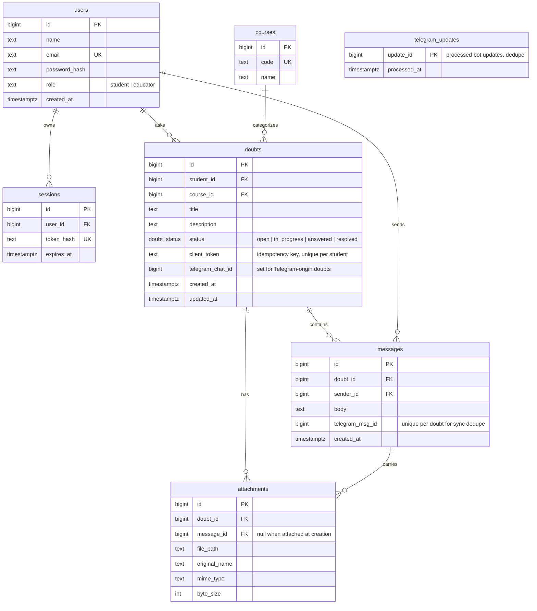

# Database schema

PostgreSQL. Migrations live in `server/db/migrations/` and are applied by `npm run migrate` (tracked in `schema_migrations`).

## ER diagram

## Design notes

- **Idempotent doubt creation:** `UNIQUE (student_id, client_token)` makes a retried submission return the original doubt instead of a duplicate.
- **Conversation model:** a doubt holds the question; replies are ordered `messages`. Attachments hang off either the doubt (creation-time image) or a specific message.
- **Indexes** on `doubts(status)`, `doubts(course_id)`, `doubts(student_id)` and `messages(doubt_id, created_at)` keep inbox filtering and thread reads cheap as volume grows.
- **Sessions** store only the SHA-256 hash of the bearer token.

- **Migration 002** is data-only (no schema change): it sets legacy `answered` doubts whose last message is not from an educator to `in_progress` (or `open` if there are no messages).
